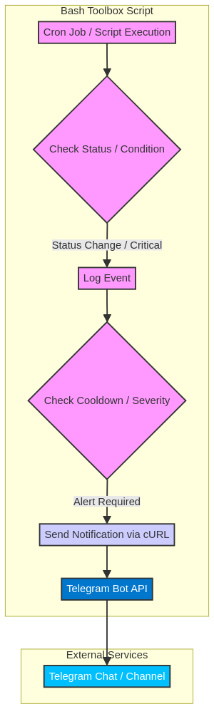

# 🧰 Bash Toolbox


[](https://github.com/ArtemRivnyi/bash-toolbox/actions/workflows/ci.yml)
[](https://github.com/ArtemRivnyi/bash-toolbox/actions/workflows/ci.yml)
[](https://github.com/ArtemRivnyi/bash-toolbox/actions/workflows/ci.yml)
[](https://opensource.org/licenses/MIT)
[](https://github.com/ArtemRivnyi/bash-toolbox/commits/main)

Collection of 70+ lightweight, production-tested, cross-platform Bash scripts for developers, sysadmins, and DevOps engineers. Automate system diagnostics, Kubernetes monitoring, service health checks, backups, log cleanup, and network auditing with minimal dependencies. Runs with automated ShellCheck and Bats CI on every push.

---

## ✨ Key Features

*   🌍 **Cross-Platform**: Linux, macOS, Windows (Git Bash)
*   📱 **Smart Telegram Alerts**: CRITICAL/WARNING/RECOVERY with cooldown protection
*   ⚡ **Minimal Dependencies**: Only standard utilities (bash, tar, curl, grep, awk)
*   🤖 **Automation-Ready**: Designed for cron jobs and CI/CD pipelines
*   🧩 **Modular**: Self-contained scripts, easy to integrate

---

## 🎯 Use Cases

| Scenario | Scripts Used | Benefit |
| :--- | :--- | :--- |
| **Small IT Teams (10-50 servers)** | `telegram-ping-monitor`, `disk-usage-alert`, `service-health-check` | Low-noise Telegram alerting without heavy monitoring stacks |
| **Edge Computing / IoT** | `system-monitor`, `internet-check` | Minimal footprint for resource-constrained devices |
| **CI/CD Pipelines** | `service-health-check`, `backup-manager` | Pre/post-deployment health verification |
| **Home Lab / Personal Servers** | `log-cleaner`, `disk-usage-alert` | Set-and-forget maintenance |

---

## 🚀 Quick Start

```shell
git clone https://github.com/ArtemRivnyi/bash-toolbox.git
cd bash-toolbox
chmod +x *.sh

# Configure and start monitoring
./telegram-ping-monitor.sh config
./telegram-ping-monitor.sh start
```

---

## 📦 Scripts

### Monitoring Scripts (with Telegram)

| Script | Description | Alert Methods |
| :--- | :--- | :--- |
| `telegram-ping-monitor.sh` | Host availability monitoring (multi-host, status transitions) | Telegram |
| `disk-usage-alert.sh` | Disk space monitoring with dual thresholds (80%/90%) | Console / Telegram / Both |
| `service-health-check.sh` | Service health (systemd/launchctl/sc) | Telegram |
| `internet-check.sh` | Multi-stage connectivity diagnostics (Ping → DNS → HTTP) | Console / Telegram / Both |
| `system-monitor.sh` | CPU/RAM/Disk monitoring with recovery alerts | Console / Telegram / Both |

### Utility Scripts

| Script | Description | Features |
| :--- | :--- | :--- |
| `quick-diagnostics.sh` | Rapid system health assessment | CPU, RAM, Disk, Connectivity checks |
| `docker-cleanup.sh` | Docker containers, images, volumes cleanup | Prunes dangling resources |
| `backup-manager.sh` | Backup creation and management | Compression, retention, restore |
| `log-cleaner.sh` | Log cleanup & rotation | Age-based, count-based, dry-run |

### 🛠️ Modular DevOps & SRE Utilities (`scripts/`)

Over 55+ single-purpose, composable utilities for cloud, containers, and Linux engineering:
* **Kubernetes**: `k8s-pod-restart-monitor.sh`, `k8s-node-resource-alloc.sh`, `k8s-configmap-diff.sh`, `k8s-events-watcher.sh`, `k8s-pvc-usage-report.sh`, `k8s-secret-decoder.sh`
* **Docker & Containers**: `docker-network-inspect-ip.sh`, `docker-image-prune-dangling.sh`, `docker-compose-validator.sh`, `docker-log-size-inspector.sh`
* **Networking & SSL**: `ssl-cert-chain-verify.sh`, `nginx-upstream-health.sh`, `tcp-syn-flood-detector.sh`, `dns-propagation-checker.sh`, `ufw-open-ports-scanner.sh`, `curl-http2-benchmark.sh`
* **Databases**: `postgres-active-connections.sh`, `postgres-vacuum-analyze.sh`, `redis-memory-usage-stats.sh`, `redis-key-count-scanner.sh`, `mongodb-replica-set-status.sh`
* **Linux Diagnostics & SRE**: `disk-io-latency-benchmark.sh`, `linux-entropy-pool-checker.sh`, `fail2ban-banned-ips.sh`, `systemd-failed-services.sh`, `linux-zombie-proc-reaper.sh`, `devops-environment-summary.sh`

All monitoring scripts share a unified command interface:

```shell
./script.sh config   # Interactive configuration
./script.sh start    # Start monitoring loop
./script.sh status   # Show current status
./script.sh test     # Test notifications
./script.sh log      # Display recent logs
./script.sh help     # Show usage info
```

---

## 🧪 Quality Assurance & CI

Every script in this repository is automatically verified through our ultra-lightweight GitHub Actions CI pipeline:
* 🔍 **Syntax Verification**: `bash -n` validation across all 70+ scripts.
* 🛡️ **Static Analysis**: [ShellCheck](https://www.shellcheck.net/) static analysis ensuring zero syntax/runtime pitfalls.
* 🧪 **Automated Tests**: [Bats (Bash Automated Testing System)](https://github.com/bats-core/bats-core) unit and integration test suite (`test/`).
* ⚡ **Resource Efficient**: Sub-30 second runner budget with concurrency cancellation (`cancel-in-progress`) and path filtering to protect GitHub Actions free tier quotas.
* ⏰ **Automated Health Beacon**: Weekly scheduled run (Every Monday at 04:00 UTC) to ensure zero bitrot over time.

To run the verification suite locally:

```shell
# Syntax verification
for f in *.sh scripts/*.sh; do bash -n "$f"; done

# ShellCheck
shellcheck *.sh scripts/*.sh

# Run Bats test suite
bats test/
```

---

## 💡 Notification Architecture

Scripts use **stateful alerting** — you only get notified on state *changes* (e.g., UP → CRITICAL, CRITICAL → RECOVERY), not on every check.



---

## 🤝 Contributing

Contributions welcome! Fork → feature branch → PR. All PRs must pass the ShellCheck and Bats test suites.

## 📄 License

MIT License. See [LICENSE](LICENSE) for details.

## 🧰 Maintainer

**Artem Rivnyi** — DevOps / Infrastructure Engineer

* 📧 [artemrivnyi@outlook.com](mailto:artemrivnyi@outlook.com)
* 🔗 [LinkedIn](https://www.linkedin.com/in/artem-rivnyi/)
* 🌐 [Portfolio & Case Studies](https://artemrivnyi.com/)
* 💻 [GitHub](https://github.com/ArtemRivnyi)

